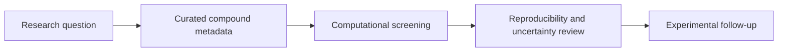

# Conceptual research architecture

This diagram is conceptual, not production topology. The original project documentation describes computational discovery and clinical decision-support research using React, FastAPI, MongoDB and retrieval systems. This portfolio excludes clinical workflows, private data, internal configuration and proprietary algorithms. Computational screening is hypothesis-generating and cannot establish clinical safety or efficacy.
